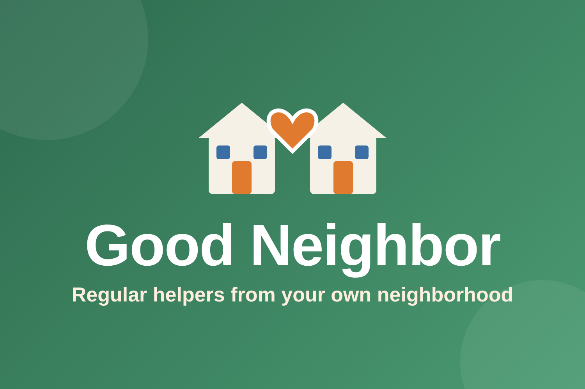
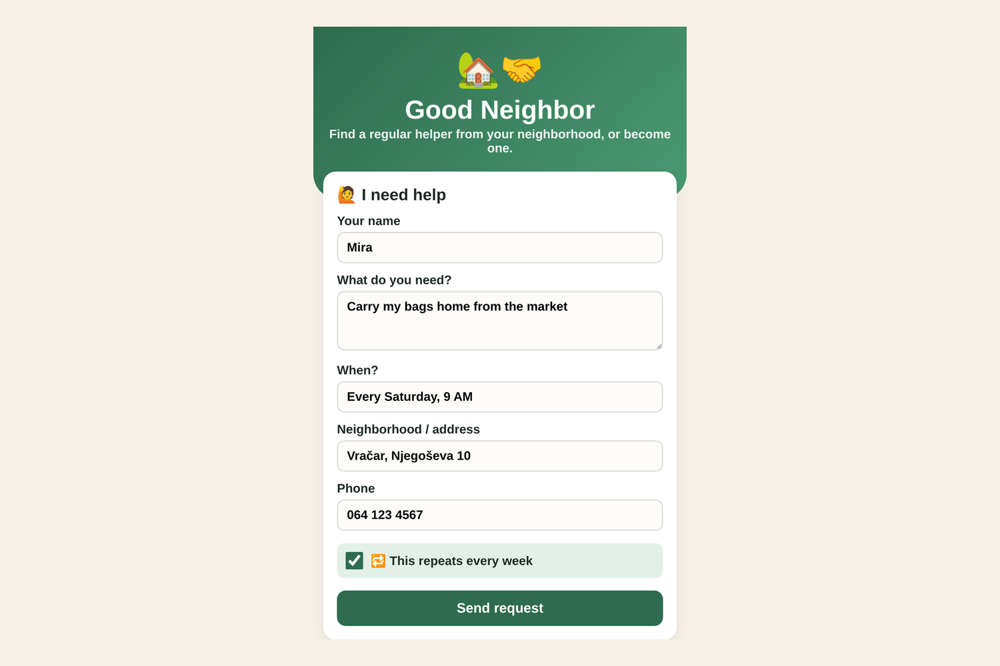
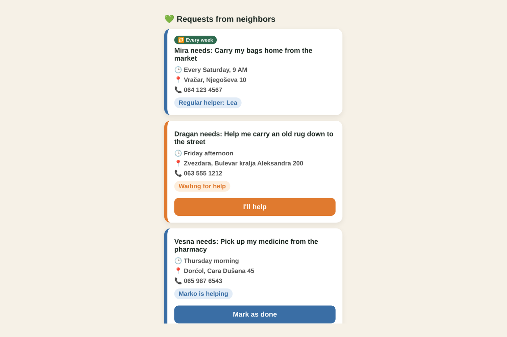
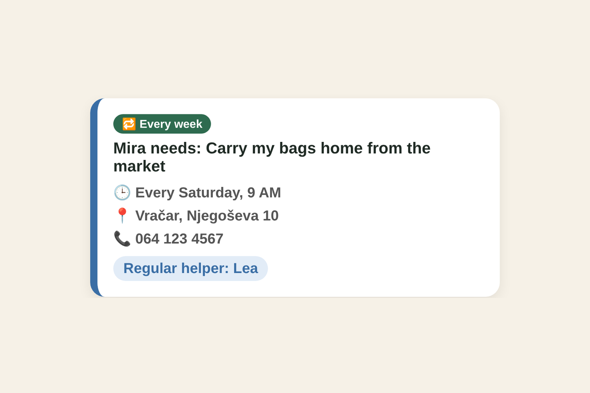

# Good Neighbor 🏡🤝

**A simple app that connects older people with a regular helper from their own neighborhood – for groceries, heavy bags, small chores, or just some company.**

Built for **Neighborhood Hacks 2026**.

## The problem
In our neighborhood we often see elderly women carrying heavy bags home from the market, alone. Many older people live by themselves and have no one nearby to ask for small, everyday help. Young neighbors would gladly help, but they don't know who needs it, and offering help to a stranger feels awkward. For older people, asking is just as hard.

## What it does
- **Ask for help** in one short form: what you need, when, where, and a phone number.
- **Offer help:** neighbors see open requests and tap **"I'll help"**.
- **Weekly requests:** tick *"This repeats every week"* and the same neighbor becomes your **regular helper**. No waiting, a familiar face, and a real connection.
- **Live updates:** requests are shared between all devices in real time.
- **Made for older users:** no accounts or passwords, large bold text, and big buttons. A grandchild or neighbor can also post a request on someone's behalf.

## Screenshots
| Ask for help | Requests | Regular helper |
|---|---|---|
|  |  |  |

## Built with
- HTML, CSS, JavaScript
- Firebase Firestore (online database, real-time updates)
- GitHub Pages (hosting)

## How to run it
Open `index.html` in a browser, or visit the live version on GitHub Pages.
To use your own database, create a Firebase project with Firestore and paste your config into the `firebaseConfig` section of `index.html`.

## Use of AI
We used Claude (an AI assistant by Anthropic) to help write and explain the code. We worked on the idea, the design decisions, and the testing.

## What's next
- Filtering requests by neighborhood
- A phone line for people without smartphones
- Partnering with local community centers and the Red Cross
